<p align="center">
  
</p>

<p align="center">
  <a href="https://github.com/netspeedy/zquota/actions/workflows/build-and-validate.yml"></a>
  <a href="https://github.com/netspeedy/zquota/releases"></a>
  <a href="https://github.com/netspeedy/homebrew-zquota"></a>
  <a href="https://netspeedy.github.io/zquota/installation/#signed-apt-repository"></a>
  <a href="https://www.python.org/"></a>
  <a href="LICENSE"></a>
  <a href="zquota.py"></a>
  <a href="https://buymeacoffee.com/soakes"></a>
</p>

---

zquota shows how much of your Z.ai quota you've used and exactly when each window
resets. Z.ai's usage charts don't make the five-hour rolling reset obvious when
you're planning work, so zquota reads the same quota API and prints your plan, a
colour-coded bar for each window, and the reset time in your own timezone.

It's a single Python file that only needs the standard library. The default view is
for people; `--compact`, `--json`, `--jsonl` and `--raw` are for scripts. `--watch`
keeps the view live, and `--threshold` exits with code 2 when a window crosses the
line you set, so cron can tell quota pressure apart from a bad key or a network
failure.

**Quick links:** [Install](#install) · [Try it](#try-it) · [Docs](https://netspeedy.github.io/zquota/) · [Quota windows](https://netspeedy.github.io/zquota/windows/) · [CLI reference](https://netspeedy.github.io/zquota/reference/cli/) · [Releases](https://github.com/netspeedy/zquota/releases)

## Install

zquota needs Python 3.12 or newer. On macOS or Linux, Homebrew is the easiest route:

```bash
brew tap netspeedy/zquota
brew install zquota
```

> On recent Homebrew, new third-party taps require explicit trust. If installation is refused, run `brew trust netspeedy/zquota` once, then `brew install zquota`.

On Debian and Ubuntu, use the signed APT repository:

```bash
sudo install -d -m 0755 /etc/apt/keyrings
curl -fsSL https://netspeedy.github.io/zquota/zquota-archive-keyring.gpg \
  | sudo tee /etc/apt/keyrings/zquota-archive-keyring.gpg >/dev/null

sudo tee /etc/apt/sources.list.d/zquota.sources >/dev/null <<'EOF'
Types: deb deb-src
URIs: https://netspeedy.github.io/zquota/
Suites: stable
Components: main
Signed-By: /etc/apt/keyrings/zquota-archive-keyring.gpg
EOF

sudo apt update
sudo apt install zquota
```

pip can install it straight from the repository:

```bash
python3 -m pip install git+https://github.com/netspeedy/zquota.git
```

Or skip installing altogether. zquota is one file, so you can download it, make it
executable and put it somewhere on your `PATH`:

```bash
mkdir -p ~/.local/bin
curl -fsSL https://raw.githubusercontent.com/netspeedy/zquota/main/zquota.py -o ~/.local/bin/zquota
chmod +x ~/.local/bin/zquota
```

To build from a checkout, run `python3 -m pip install .` in the cloned repository.

## Try it

Set your API key and run it:

```bash
export ZAI_API_KEY='your-api-key'
zquota
```

You get your plan and a block for each quota window:

```text
  Z.ai plan: pro

  │  5-Hour Rolling Token Quota
  │
  │  [████████████░░░░░░░░░░░░] 50% used
  │  Remaining: 50%
  │  Limit:      1.0M
  │  Used:       500.0k
  │  Remaining:  500.0k
  │  Resets in:   30m
  │  Resets at:   2026-05-23 15:00:00 BST
  ──────────────────────────────────
```

The bar turns yellow at 70% and red at 90%. Reset times are shown in
`Europe/London` unless you pass `--timezone` or set `ZAI_TIMEZONE`. Flags win over
environment variables. A few common ones:

```bash
zquota --compact                 # one line per quota
zquota --timezone America/New_York
zquota --watch 30                # live, refresh every 30s
zquota --threshold 80            # exit 2 if any quota is at/above 80%
```

The [docs](https://netspeedy.github.io/zquota/) cover
[configuration](https://netspeedy.github.io/zquota/guides/configuration/), timezones and
[reset times](https://netspeedy.github.io/zquota/windows/reset-times/), the
[JSON fields](https://netspeedy.github.io/zquota/reference/json-output/), a
[cron example](https://netspeedy.github.io/zquota/guides/scripting/) and
[troubleshooting](https://netspeedy.github.io/zquota/guides/troubleshooting/).

## Configuration

zquota reads its settings from the environment:

| Variable | Required | Description | Default |
|---|:---:|---|---|
| `ZAI_API_KEY` | yes | Bearer token used to query the quota endpoint | none |
| `ZAI_API_URL` | no | Alternate quota endpoint, mainly useful for testing | `https://api.z.ai/api/monitor/usage/quota/limit` |
| `ZAI_TIMEZONE` | no | Timezone used for displayed reset times | `Europe/London` |

`--api-key` also works, but a key on the command line ends up in your shell history
and the process list, so the environment variable is the better habit.

## Output formats

Only one format flag can be used at a time:

| Format | Flag | Use case |
|---|---|---|
| Pretty | default | Human-readable terminal output |
| Compact | `--compact` | One line per quota |
| JSON | `--json` | Scripting, dashboards, and `jq` |
| JSON Lines | `--jsonl` | Logs and append-only collection |
| Raw | `--raw` | Debugging the upstream API response |

The JSON formats carry the reset time three ways: `resets_at` in your timezone,
`resets_at_utc` and `reset_epoch_ms`.

```bash
zquota --json | jq '.quotas[] | {quota: .name_compact, local: .resets_at, utc: .resets_at_utc}'
```

```json
{
  "quota": "5h-rolling",
  "local": "2026-05-23 15:00:00 BST",
  "utc": "2026-05-23T14:00:00Z"
}
```

## Exit codes

| Code | Meaning |
|---:|---|
| `0` | Success |
| `1` | Runtime or input error |
| `2` | Threshold exceeded when `--threshold` is set, or a command line that doesn't parse |
| `130` | Interrupted with Ctrl-C, except during `--watch`, where Ctrl-C stops it with 0 |

Quota pressure gets its own code so that a script can tell it apart from a broken
API key, a network failure or an invalid response. Python's argument parser also
exits with 2 for an unknown flag or two output formats at once, after printing
`usage:` to standard error, so check a new command by hand before a script relies
on the 2.

## Development

Create a virtual environment and install the development tools:

```bash
python3 -m venv .venv
. .venv/bin/activate
python3 -m pip install -e '.[dev]'
```

These checks are the minimum before a change lands:

```bash
make fmt-check
make lint
make test
make smoke
make version-check
```

`make fmt` formats with black and `make build` builds the Python package. The
[docs site](https://netspeedy.github.io/zquota/) is built with Astro and Starlight
from `website/`, and its [README](website/README.md) covers the `make website-*`
targets and how the site is published. If you add, rename or remove a flag, update
the CLI reference page in the same change: `tests/test_docs.py` fails until the
page matches. Releases are automated; [docs/release.md](docs/release.md) describes
the flow.

The banner at the top of this page and the social cards are generated. Edit the
copy, layout or timing in `scripts/readme/build_readme_hero.py` and run `make
readme-hero`. That rebuilds `assets/zquota-readme-hero.svg`, the website's share
card, mark and icons, and `assets/zquota-social-card.png`, which is the
image for GitHub's social preview and is uploaded by hand in the repository
settings. It runs the script with `uv`, which installs the pinned fontTools it
subsets the fonts with, and renders the cards with headless Chrome or Chromium. The
fonts come from assets.netspeedy.io, so the first run needs network access. If you
change the headline's words, measure them again with `uv run
scripts/readme/measure_headline.py`.

Issues and pull requests are welcome. [AGENTS.md](AGENTS.md) has the full repository
conventions.

## License

Copyright © 2026 [Simon Oakes](https://github.com/soakes). Released under the
[MIT License](LICENSE).

`zquota` is an unofficial community tool and is not affiliated with, endorsed by, or
sponsored by [Z.ai](https://z.ai).
